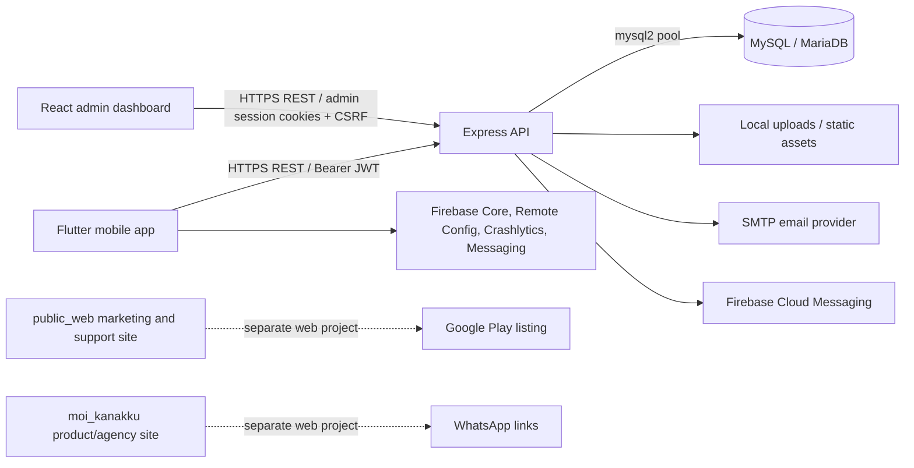
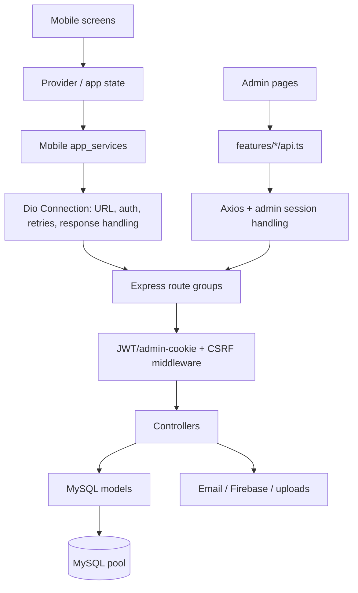

# Moi Kanakku Application Floorplan

Repository-level architecture map, prepared from the checked-in source on 2026-11-21. This describes code and schema found in this workspace; it does not assert that every configured integration is enabled in production.

## System at a glance

The central product is Moi Kanakku: a mobile app backed by a REST API and a separate admin dashboard. `public_web/` and `moi_kanakku/` are additional web applications in this repository; source inspection shows they are not wired into the API as first-party clients in the same way as `mobile-app/` and `admin-app/`.

## Frontend applications and screens

### `mobile-app/` — Flutter end-user app

- **Startup and navigation:** `lib/main.dart`, `lib/my_app.dart`, `lib/app_configs/app_routes.dart`; GoRouter routes into splash and the authenticated main shell. `AuthGuard` and protected-route configuration gate user screens.
- **Account access:** login, signup, Google sign-in/profile setup, set/change/reset password, forgot-password OTP, account restore OTP, onboarding, and email verification.
- **Home and app shell:** dashboard/home, bottom navigation, drawer, profile, settings, contact, feedback, notifications, app alerts, maintenance, force-update, no-internet, permission and configuration-error screens.
- **Moi bookkeeping:** function list/add/edit/details; transaction dashboard/list/add/edit/details; person details/edit; function-specific transaction list; totals and search.
- **Upcoming functions:** list, details, add/edit, reminder-related controls.
- **Shared app layers:** `app_services/` owns API calls, `app_models/` maps response data, `app_utils/app_providers/` holds shared user/language/connectivity state, `app_storages/` wraps secure storage, and `app_themes/` defines presentation tokens. PDF export/sharing and speech input are utility features.
- **Main client dependencies/integrations:** Dio for HTTP; `flutter_secure_storage` for credentials; Provider for shared state; GoRouter for routing; `google_sign_in`; Firebase Core, Remote Config, Crashlytics and Messaging; local biometrics; image picker/cropper; PDF and printing packages; device/connectivity/permission plugins; speech-to-text; Play Store links.

### `admin-app/` — React administration dashboard

- **Entry and shell:** `src/main.tsx`, `src/App.tsx`, `components/layout/AdminLayout.tsx`; React Router lazy-loads screens inside the admin layout.
- **Public access screens:** login, MFA verification, password reset, not-found.
- **Admin screens:** dashboard; user list/detail; a user's person/function/transaction detail; transactions; functions; upcoming functions; feedback; notifications; app alerts; user OTPs; audit logs; database backup; settings; runtime app configuration; MFA setup.
- **Feature API modules:** `src/features/*/api.ts` groups backend calls for auth, dashboard, users, persons, transactions, transaction functions, upcoming functions, feedback, notifications, alerts, OTPs, audit logs, backups and runtime config.
- **Shared client layer:** `src/lib/axios.ts` configures HTTP; `auth.ts`, `secureStorage.ts`, `sessionKeepAlive.ts` manage browser session state; TanStack Query caches server data; Zustand is available for local state; shared components provide layout, forms, filters, dialogs and tables.
- **Main dependencies:** React, Vite, TypeScript, React Router, TanStack Query, Axios, Zustand, Firebase client SDK (dependency present), charts, Radix/shadcn-style UI, React Hook Form/Zod, Socket.IO client (dependency present).

### Companion web projects

- **`public_web/`:** TanStack Router site with home, about, services, locations and city pages, Moi app, contact, terms, privacy and account-deletion pages. Components and content data are in `src/components/` and `src/data/`. It uses a separate Vite/TanStack Start web stack. A direct runtime dependency on the Moi API was not evident from the route and server entry points inspected.
- **`moi_kanakku/`:** separate TanStack Router showcase site with home and product detail routes. Its forms, WhatsApp actions, product/service/project data and visual components are local site modules. It is not the Flutter mobile app despite the similar directory name.

## Backend services and API surface

`backend/app.js` starts Express, applies CORS, Helmet, request logging, JSON/form parsing, cookies, static uploads/assets and global error handling. `/health` is separate from `/apis`; all `/apis` routes receive a general rate limiter from `src/routes/index.js`. Controllers handle HTTP orchestration, models contain MySQL queries, helpers normalize IDs/schema/validation, and services handle cross-request/background work.

| API group (under `/apis`) | Main responsibility | Route/controller area |
|---|---|---|
| `/users`, `/auth`, `/sessions` | User registration/login, Google login, profile/password, account restore/delete, referral code, admin login/session/refresh/logout | `routes/user.js`, `routes/sessions.js` → `controllers/user.js` |
| `/mfa` | TOTP enrollment, verification, status, disable and backup codes for user/admin | `routes/mfaRoutes.js` → `controllers/mfaController.js` |
| `/persons` | User-owned person directory and admin person inspection/maintenance | `moiPersons` |
| `/transaction-functions` | User function/event records attached to transaction activity | `transactionFunctions` |
| `/transactions` | Create/list/detail/update/delete, stats and person lookup; admin list/delete | `transactions` |
| `/moi-default-functions`, `/moi-defaultfunctions`, `/default` | Default function choices and totals | `moiDefaultFunctions`, `default` |
| `/upcoming-functions`, `/upcoming-function` | User reminders/events and admin list | `upcomingFunction` |
| `/notification` | User inbox state plus admin targeted/bulk send/manage | `notificationRoutes` |
| `/app-alert` | User-facing alert actions and admin alert management | `appAlertRoutes` |
| `/app-config` | Public runtime config and admin read/update | `appRuntimeConfigRoutes` |
| `/feedbacks` | User submission/list and admin review/reply/delete | `feedbacks` |
| `/email` | Email/OTP verification and admin email operations | `emailRoutes` |
| `/uploads` | Authenticated upload and image deletion; files served from static `/uploads` | `uploadRoutes` |
| `/admin` | Admin OTP/audit-log operations and database backup listing/download/delete | `adminRoutes` |
| `/dashboard` | Dashboard summaries and analytics | `dashboard` |

`/health`, `/health/live` and `/health/ready` expose health checks outside the API namespace. Some routes intentionally have public operations (for example login, registration, password reset, email verification, public runtime config); they still sit behind global API rate limiting, and selected account-creation endpoints have additional key/rate checks.

## Database map

The checked-in November 18, 2026 backup `backup/moi-kanakku-2026-11-18133957.sql` lists these tables. Table names below are schema evidence, not a guarantee that the current production database is identical. `users` is the core account root; the data model is MySQL/MariaDB via `mysql2/promise` pool in `src/config/database.js`.

| Table(s) | Role / relationship |
|---|---|
| `users` | End-user accounts and account status/auth metadata; root for user-owned data. |
| `user_profiles` | Profile extension; FK to `users` with cascade. |
| `user_credentials` | Credential records; FK to `users` with cascade. |
| `user_devices` | Registered devices/push-token state; FK to `users` with cascade. |
| `user_sessions` | Persistent session records; FK to `users` with cascade. |
| `user_mfa` | User MFA/TOTP state; user association is application-managed in the inspected dump (no FK declaration shown). |
| `user_otps` | OTP/verification records; FK to `users` with cascade. |
| `user_referrals` | Referrer and referred user links; both FKs to `users` with cascade. |
| `persons` | User's contact/contributor directory. User association is represented by the schema/application; transaction relation is enforced as below. |
| `transaction_functions` | User function/event categories/records referenced by transactions; transaction ownership is also scoped by application queries. |
| `transactions` | Credit/debit gift entries. FK to `persons` and `transaction_functions`, both cascade on delete. Dump contains duplicate equivalent FK declarations for each relationship. |
| `default_functions` | Shared default function catalog. |
| `upcoming_functions` | Scheduled user events; FK to `users` with cascade. |
| `notifications` | User inbox messages/read/deleted state; FK to `users` with cascade. |
| `feedbacks` | Feedback submissions; FK to `users` with cascade. |
| `user_audit_logs` | User activity/audit records; FK to `users` with cascade. |
| `admins` | Separate administrator accounts. |
| `app_alerts` | Admin-authored app alert definitions. |
| `app_alert_user_states` | Per-user state for alerts; FKs to `app_alerts` and `users`, both cascade. |
| `app_runtime_config` | Global runtime settings; `updated_by` references `admins`, set null on admin deletion. |

Logical data chain: **user → persons → transactions ← transaction_functions**. The SQL dump explicitly enforces the two transaction links, but user ownership filters and some relationships are implemented in model/controller SQL rather than declared foreign keys. The app-level ownership rules should be verified in the relevant model queries before relying on them as a database constraint.

## Authentication and authorization

- **End users:** login/Google login returns access credentials; Flutter's shared `Connection` adds `Authorization: Bearer …` from secure storage. JWT middleware checks signature/type, session acceptance, current account existence/status and attaches the decoded user identity. User routes usually call `authenticateToken`.
- **Administrators:** dashboard login uses separate admin credentials and session handling. Browser auth uses HttpOnly access/refresh cookies with a CSRF token header for mutations; backend middleware also supports Bearer auth. Admin endpoints are guarded by `authenticateAdminToken`, and the route layout is the client-side shell rather than the security boundary.
- **MFA:** shared MFA routes allow user-or-admin identity and implement TOTP setup/verification/status/disable/backup-code actions. Admin dashboard exposes setup and login verification screens.
- **Additional controls:** global and route-specific rate limiting; API key checks on selected creation endpoints; account status/deletion checks; CORS allowlist; Helmet; password hashing; secure mobile storage. API authorization remains authoritative even when the UI hides routes.

## External integrations and stored files

- **Firebase:** mobile initializes Firebase Core and uses Remote Config, Crashlytics, and FCM. Backend uses Firebase Admin for sending push notifications and checking/processing token health. Credentials/configuration are environment/deployment supplied; source presence alone does not prove deployed credentials are valid.
- **Google identity:** mobile `google_sign_in` obtains a sign-in result; backend `google-auth-library` verifies Google login credentials in the user controller.
- **Email:** backend `nodemailer` email service/controllers send OTP, verification, password/security and admin broadcast messages through configured SMTP.
- **MySQL/MariaDB:** backend's primary persistence layer.
- **Local filesystem:** Multer-managed uploads and static `/uploads`, `/assets`; backup controller handles database backup artifacts. Deployment storage/retention settings are external configuration.
- **Mobile device services:** biometric authentication, device metadata/connectivity/permissions, native notifications, speech recognition, PDF/share/print, image selection/cropping, and Play Store open/review are accessed through Flutter plugins and OS APIs.
- **Web links:** marketing/showcase sites and mobile PDFs can link to Google Play; showcase site has WhatsApp contact links. These are outbound links, not evidence of server-side APIs.

## Dependency and request flow

Primary dependency direction is **screens → client services → HTTP → backend routes → controllers → models → database**. Controllers/services call external integrations for email, push messages, uploaded files and scheduled reminders. The admin app follows the same API but has its own browser session and feature API modules. The mobile app also calls Firebase directly for client-side services; those calls do not pass through the Moi REST API.

## Background work

`backend/app.js` schedules daily work in `Asia/Kolkata`: password-expiration checks and FCM token health at 09:00, and upcoming-function reminders at 06:00. `backgroundJobQueue.js` and messaging isolate worker files support queued/isolated messaging paths. These jobs depend on the same database and email/push integrations as request handlers.

## Verification limits and review notes

- This is a source-derived architecture map, not an execution trace. Inferred links are shown as dotted lines in diagrams.
- Schema relationships are based on the checked-in SQL dump; verify against the deployed schema and migrations before making data-integrity decisions.
- `public_web/` and `moi_kanakku/` appear to be separately deployable sites; their shared product branding does not establish a runtime dependency on the API.
- Some `package.json` dependencies may be unused or loaded only in particular builds. The list above calls out dependencies visible in configuration and code, not a complete use-site audit.
- The root README is the quickest orientation. Key implementation references: `backend/src/routes/index.js`, `backend/app.js`, `mobile-app/lib/app_configs/app_routes.dart`, `mobile-app/lib/app_services/`, `admin-app/src/App.tsx`, `admin-app/src/features/`, and the SQL dump cited above.
